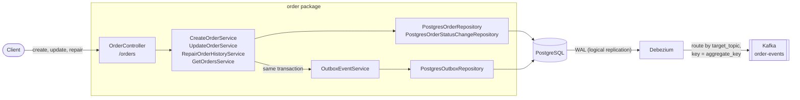
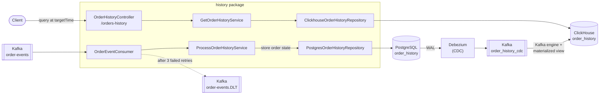

# ClickHouse as a Read Replica of PostgreSQL with Debezium and Kafka

This repository is a practical implementation of **ClickHouse as a read-only replica of PostgreSQL**, built with a
**Spring Boot + Kotlin** application. The application writes the order history only to **PostgreSQL**, inside
transactions. **Debezium** captures every change, including updates and deletes, and **ClickHouse** consumes the
changes from Kafka and answers point-in-time queries (time travel) over every state of an order.

The events that feed the order history are published with the **Transactional Outbox Pattern**, so an order change
and its event are always saved together.

## What Problem Am I Trying to Practice?

### The Business Scenario: Orders and Their History
The application manages orders. An order is created, changes its status (`CREATED`, `PROCESSING`, `COMPLETED`, `CANCELLED`), and can have its total amount corrected. PostgreSQL stores the current state of each order.

The order history keeps every state of each order, so it can show how all orders looked at any point in time. It is updated asynchronously from Kafka events and stored in PostgreSQL; a CDC pipeline replicates it into ClickHouse, which answers the time travel queries.

### The Analytical Problem: Fast Time Travel Reads
Time travel queries scan the history of many orders, which becomes slow in PostgreSQL as the history grows and
competes with the transactional load. ClickHouse answers such queries quickly, but handles single-row updates and
deletes poorly.

### The Solution: ClickHouse as a Read Replica
1. The application writes the order history only to PostgreSQL, inside transactions.
2. A Debezium connector captures every change of `order_history`, including updates and deletes.
3. ClickHouse consumes these changes with its Kafka table engine and stores them as a **read-only replica**. The
   application never writes to ClickHouse.
4. The order history API reads only from ClickHouse.

### The Architectural Problem: Dual Writes
Saving the order in PostgreSQL and then publishing an event to Kafka are two separate writes, and either can fail on its own:
* **Kafka fails after the database commit:** The order is saved, but the event is lost, so the history never sees the change.
* **The database fails after the event is sent:** The history records a change that was rolled back.

### The Solution: Transactional Outbox
1. The application writes the order change and an event row in the `outbox` table in **one PostgreSQL transaction**. Both are saved, or neither is.
2. **Debezium** reads the outbox rows from the PostgreSQL write-ahead log (WAL) and publishes them to Kafka.
3. The order history consumer reads the events and stores the new state of the order in the PostgreSQL `order_history` table. If the consumer is down, the events stay in Kafka until it recovers. Events that still fail after 3 retries go to a dead letter topic.

---

## Architecture Overview

**Write path:** from the order API to Kafka.



**Read path:** from Kafka to PostgreSQL, replicated into ClickHouse, and read by the order history API.



* **Write side (`order` package):** Stores orders and their status timeline in PostgreSQL and writes one outbox row per change in the same transaction.
* **Event routing:** The Debezium Outbox Event Router reads the `target_topic` column to choose the Kafka topic (`order-events`) and uses `aggregate_key` (the customer ID) as the message key.
* **Read side (`history` package):** Consumes the events and stores every order state in the PostgreSQL `order_history` table. Debezium replicates every change into the ClickHouse `order_history` table (`ReplacingMergeTree`), which the history API reads. See [ADR 0003](docs/adr/0003-clickhouse-read-replica-for-order-history.md).

The application publishes four event types:

| Event                        | Trigger                            | Effect on the order history                                 |
|------------------------------|------------------------------------|-------------------------------------------------------------|
| `ORDER_CREATED`              | `POST /orders`                     | Stores the first state of the order                         |
| `ORDER_STATUS_UPDATED`       | `PUT /orders/{id}/status`          | Stores a new state with the new status                      |
| `ORDER_TOTAL_AMOUNT_REPAIR`  | `PUT /orders/{id}/total-amount`    | Repairs the amount in every stored state of the order       |
| `ORDER_REPAIR`               | `POST /orders/{id}/history-repair` | Rebuilds every state from the PostgreSQL status timeline    |

---

## Technologies Used
The application stack is built entirely using containerized modern enterprise technologies:

* **Backend Framework:** Spring Boot 4 with **Kotlin** on Java 21
* **Transactional Database:** PostgreSQL 16
* **Analytical Database:** ClickHouse 26.8, a read-only replica of the order history
* **Database Migrations:** Flyway
* **Message Broker:** Apache Kafka
* **Change Data Capture (CDC):** Debezium Connect 3.7 with the Outbox Event Router SMT (outbox) and the
  ExtractNewRecordState SMT (order history replication)
* **Infrastructure Orchestration:** Docker & Docker Compose

---

## How to Run the Application Locally

1. **Install Prerequisites**
   Ensure that **Java 21** (or compatible JDK) and **Docker Desktop / Engine** are installed and running on your machine.

2. **`./gradlew clean bootJar`**
   Compiles the Kotlin source code and generates the executable application archive inside the local build directory.

3. **`cd infra`**
   Navigates into the infrastructure folder containing the orchestrator configuration assets.

4. **`docker compose --profile app up --build -d`**
   Builds the application image and spins up the entire architectural service stack in the background.

5. **Verify `http://localhost:8080/actuator/health`**
   Accesses the Spring Boot diagnostics interface to confirm the server, database, and broker connections are fully operational.

6. **Verify `http://localhost:8082`**
   Opens the Provectus Kafka UI control plane dashboard in your web browser to monitor topics and live event streams.

7. **Verify `http://localhost:8083/connectors/postgres-outbox-connector/status` and `http://localhost:8083/connectors/postgres-order-history-connector/status`**
   Queries the Debezium Connect REST API directly to verify that both connectors and their tasks are `RUNNING`.

8. **Verify `http://localhost:8080/orders-history`**
   Returns the current order history from ClickHouse.

9. **`docker compose --profile app down`**
   Stops and removes all running containers safely when you are finished developing.

10. **`docker compose --profile app down -v`**
    Stops the containers and permanently deletes the PostgreSQL and ClickHouse data volumes to trigger fresh Flyway migrations on the next run.

### Running the Application in IntelliJ IDEA
The `app` service belongs to the `app` Compose profile. Run `docker compose up -d` in the `infra` folder to start every service except the application, then run or debug the main class in IntelliJ. See [infra/README.md](infra/README.md) for details.

### Service Access Ports

| Service                  | Address                                                  |
|--------------------------|----------------------------------------------------------|
| Spring Boot Application  | `http://localhost:8080`                                  |
| Swagger UI               | `http://localhost:8080/swagger-ui.html`                  |
| Kafka UI                 | `http://localhost:8082`                                  |
| Kafka Connect REST API   | `http://localhost:8083/connectors`                       |
| PostgreSQL               | `localhost:5432` (`order_db`)                            |
| ClickHouse HTTP / native | `localhost:8123` / `localhost:9000` (`orders_analytics`) |
| ClickHouse SQL UI        | `http://localhost:8123/play`                             |
| Kafka (host listener)    | `localhost:9092`                                         |

---

## Documentation

* **Architecture Decision Records**
  * [ADR 0001: Outbox and CQRS](docs/adr/0001-architecture-decisions-for-outbox-and-cqrs.md)
  * [ADR 0002: Kafka Consumer Dead Letter Queue](docs/adr/0002-resilience-kafka-consumer-dlq.md)
  * [ADR 0003: ClickHouse Read Replica for the Order History via CDC](docs/adr/0003-clickhouse-read-replica-for-order-history.md)
* **Runbooks**
  * [Order History CDC Sync](docs/runbook/order-history-cdc-sync.md)
  * [Kafka Poison Pill Handling](docs/runbook/kafka-poison-pill-handling.md)
* **Infrastructure**
  * [Docker Compose and IntelliJ Setup](infra/README.md)

---

## Code Style

Kotlin code style is enforced with [ktlint](https://pinterest.github.io/ktlint/) (rules configured in `.editorconfig`). `ktlintCheck` runs as part of `./gradlew check`.

* **`./gradlew ktlintCheck`** - Reports code style violations.
* **`./gradlew ktlintFormat`** - Automatically fixes code style violations.

---

## Troubleshooting & Useful Commands

* **`docker compose ps`**
  Displays the current operational state and port bindings of all containers to quickly verify which services are healthy or crashing.

* **ClickHouse log warnings**
  `Delay accounting is not enabled` and `Integrity check of the executable skipped` are harmless in the container: delay accounting depends on a kernel setting, and the official image may not include a reference checksum.

* **`docker compose logs app -f`**
  Tails the live log stream of the Spring Boot application (change `app` to `debezium`, `connector-init`, `kafka`, or `clickhouse` to inspect other services) to capture startup exceptions or connection failures.

* **`http://localhost:8123/play`**
  Opens the ClickHouse SQL UI (user `ch_user`) to inspect the raw rows of `order_history`, including every
  replicated change (use `FINAL` to see only the current rows).

* **`docker compose build --no-cache`**
  Forces Docker to completely wipe out its internal build memory layers and download all script assets fresh, bypassing corrupted local caches.

* **`docker compose --profile app down -v`**
  Stops all running containers and permanently deletes the PostgreSQL and ClickHouse data volumes, allowing you to re-run Flyway migrations from scratch.

* **`curl http://localhost:8083/connectors/postgres-outbox-connector/status`**
  Queries the Debezium engine directly to check if your outbox connector has been registered successfully and is currently monitoring the database transaction log. Replace the name with `postgres-order-history-connector` to check the CDC sync into ClickHouse.

---

## Debezium Connector Configuration & Automation

Debezium runs two connectors that both read the PostgreSQL write-ahead log. The outbox connector, configured in
[`infra/debezium-outbox-connector.json`](infra/debezium-outbox-connector.json), uses the Debezium Outbox Event
Router SMT (Single Message Transform) to stream only the event payload into the target Kafka topic.

The key settings are:

* **`table.include.list`:** `public.outbox`, the only table Debezium streams.
* **`topic.prefix`:** The logical server name (replaces `database.server.name` from Debezium 1.x).
* **`transforms.outbox.route.by.field`:** `target_topic`, so each outbox row chooses its Kafka topic.
* **`transforms.outbox.table.field.event.key`:** `aggregate_key`, the customer ID, which keeps the events of one customer in order on one partition.
* **`value.converter`:** `StringConverter`, because the `payload` column already holds the serialized JSON event.

A second connector, [`infra/debezium-order-history-connector.json`](infra/debezium-order-history-connector.json), replicates the `order_history` table into ClickHouse. [ADR 0003](docs/adr/0003-clickhouse-read-replica-for-order-history.md) explains its settings.

The `connector-init` service in [`infra/docker-compose.yml`](infra/docker-compose.yml) registers both connectors automatically. It waits for the Kafka Connect REST API, creates or updates each connector with an idempotent `PUT`, and fails if a connector task does not reach the `RUNNING` state.

To register the connector manually from the `infra` folder instead, run:
```bash
curl -X PUT -H "Content-Type: application/json" --data @debezium-outbox-connector.json http://localhost:8083/connectors/postgres-outbox-connector/config
curl -X PUT -H "Content-Type: application/json" --data @debezium-order-history-connector.json http://localhost:8083/connectors/postgres-order-history-connector/config
```