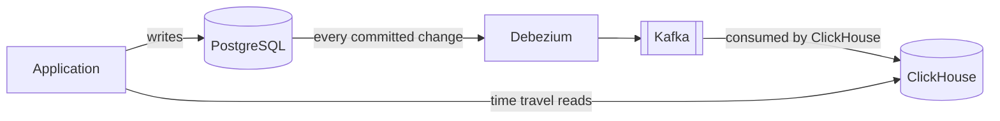
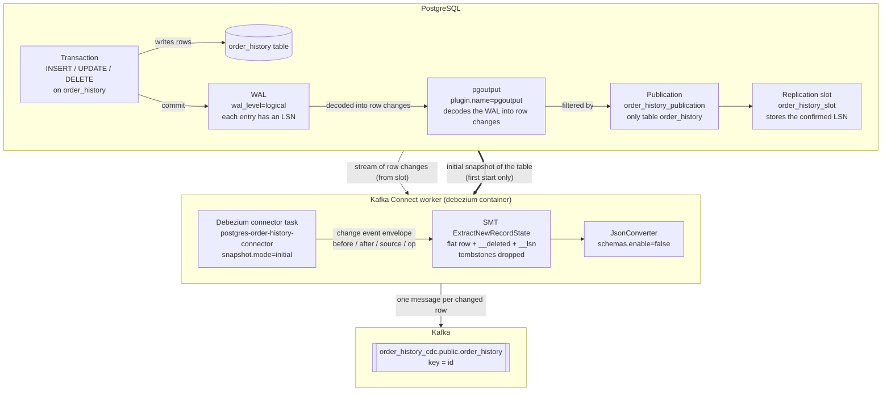
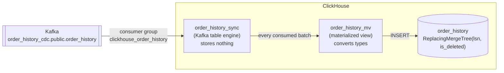

# ADR: ClickHouse Read Replica for the Order History via CDC

## Status

Accepted

## Context

PostgreSQL stores the orders and their history, one row per state (creation and each status change), which enables
time travel. Single-row writes are fast and transactional in PostgreSQL, but time travel snapshots scan the history of
many orders and reduce it to the latest state per order. As the history grows, these analytical queries become slow and
compete with the transactional load.

**ClickHouse**, a columnar OLAP store, answers such queries quickly, but handles single-row changes poorly: no
transactions across statements, patch-based updates and deletes, and only eventual deduplication. We therefore need
every modification to stay transactional in PostgreSQL while time travel reads are served from ClickHouse, without the
application writing to both databases.

## Decision

PostgreSQL remains the only database the application writes to. ClickHouse becomes a **read-only replica** of the
order history, kept in sync by **change data capture (CDC)**, and the order history endpoint reads only from
ClickHouse.



1. **Capture:** Debezium reads every committed change of the order history from PostgreSQL's transaction log,
   including updates and deletes, and publishes it to Kafka.
2. **Ingest:** ClickHouse consumes these messages itself and stores every change as a new row. No additional service
   is needed.
3. **Replicate corrections:** retroactive amount repairs and history repairs reach ClickHouse like any other change,
   so past snapshots show the corrected data.
4. **Read:** a time travel query first takes the latest version of each replicated row, then the latest state of each
   order up to the requested time.


### Components

| Component                   | Source                                                                                                       |
|:----------------------------|:-------------------------------------------------------------------------------------------------------------|
| PostgreSQL table            | [`db/migration/postgres/V2__create_order_history_table.sql`](../../src/main/resources/db/migration/postgres/V2__create_order_history_table.sql) |
| Debezium connector          | [`infra/debezium-order-history-connector.json`](../../infra/debezium-order-history-connector.json)            |
| ClickHouse tables and view  | [`db/migration/clickhouse/V1__create_order_history_table.sql`](../../src/main/resources/db/migration/clickhouse/V1__create_order_history_table.sql) |
| Write path                  | `ProcessOrderHistoryService`, `PostgresOrderHistoryRepository`                                               |
| Read path                   | `GetOrderHistoryService`, `ClickhouseOrderHistoryRepository`                                                 |

### 1. Write Side: PostgreSQL

#### Table

| Column / constraint             | Purpose                                                                                     |
|:--------------------------------|:--------------------------------------------------------------------------------------------|
| `id UUID PRIMARY KEY`           | One row per state of an order (creation and each status change)                             |
| `UNIQUE (order_id, updated_at)` | Finds the timeline of an order and rejects the same state change stored twice               |
| `updated_at`                    | Time of the state change; drives time travel                                                |
| `version`                       | Optimistic locking (Spring Data `@Version`): increased on every update of the row           |
| `REPLICA IDENTITY FULL`         | Update and delete events in the WAL carry the whole row, not only the primary key           |

#### Write rules

`ProcessOrderHistoryService` applies every Kafka event inside one transaction:

| Event                       | Statement in PostgreSQL                                                                         |
|:----------------------------|:------------------------------------------------------------------------------------------------|
| `ORDER_CREATED`             | `INSERT` of the first state; skipped if the order already has a history (redelivery)            |
| `ORDER_STATUS_UPDATED`      | `INSERT` of a new state; skipped if its `updatedAt` is not later than the latest state          |
| `ORDER_TOTAL_AMOUNT_REPAIR` | `UPDATE order_history SET total_amount = ?, version = version + 1 WHERE order_id = ?`           |
| `ORDER_REPAIR`              | `DELETE` of every row of the order, then `INSERT` of the repaired timeline                      |

A missing history and an optimistic locking conflict are rethrown, so the Kafka retry and dead letter handling of
[ADR 0002](../adr/0002-resilience-kafka-consumer-dlq.md) applies.

### 2. Capture: Debezium

Debezium reads the PostgreSQL write-ahead log through logical replication (`wal_level=logical`, plugin `pgoutput`)
and publishes every row change to Kafka.



The diagram shows how one committed change in PostgreSQL becomes one Kafka message:

1. **PostgreSQL produces the change stream.** A committed transaction is written to the WAL (write-ahead log), the log of every change,
   where each entry has a position (LSN or log sequence number). `pgoutput` (built-in output plugin) decodes the WAL into row changes, the publication keeps only
   those of `order_history`, and the replication slot remembers how far Debezium has read, so no change is lost while
   Debezium is down.
2. **Kafka Connect reshapes each change.** The Debezium task receives an envelope (`before`, `after`, `source`, `op`).
   `ExtractNewRecordState` flattens it to the row itself, adds `__deleted` and `__lsn` and drops tombstones, and
   `JsonConverter` writes it as plain JSON.
3. **Kafka stores the result.** Each changed row becomes one message on `order_history_cdc.public.order_history`,
   with the row `id` as key.

The thick arrow is the initial snapshot: on the first start only, Debezium copies the existing rows of
`order_history` before streaming the changes from the replication slot.

| Setting                                                                                                              | Effect                                                                                                                                                                                                                       |
|:---------------------------------------------------------------------------------------------------------------------|:-----------------------------------------------------------------------------------------------------------------------------------------------------------------------------------------------------------------------------|
| `table.include.list=public.order_history`, `topic.prefix=order_history_cdc`                                          | Captures only this table. The topic name combines the prefix, the schema and the table (`<topic.prefix>.<schema>.<table>`): `order_history_cdc.public.order_history`                                                         |
| `slot.name=order_history_slot`, `publication.name=order_history_publication`, `publication.autocreate.mode=filtered` | Own replication slot and publication; the outbox connector uses the default slot, and two connectors cannot share one                                                                                                        |
| `snapshot.mode=initial`                                                                                              | Copies every existing row once, then streams the changes                                                                                                                                                                     |
| `decimal.handling.mode=string`                                                                                       | Sends `total_amount` as an exact decimal string                                                                                                                                                                              |
| `ExtractNewRecordState` (`transforms.unwrap`)                                                                        | Replaces Debezium's `before`/`after` envelope with the flat row (see the example message below)                                                                                                                              |
| `delete.tombstone.handling.mode=rewrite`                                                                             | A delete is sent as the deleted row with `__deleted = "true"`. The tombstone (a message with the row's key and an empty value, used by compacted Kafka topics to remove a key) is dropped, because ClickHouse cannot read it |
| `add.fields=lsn`                                                                                                     | Adds the WAL position of the change as `__lsn`                                                                                                                                                                               |
| `JsonConverter` with `schemas.enable=false`                                                                          | Plain JSON keys and values, without the schema block                                                                                                                                                                         |

After `ExtractNewRecordState`, a message for an inserted row looks like this:

```json
{
  "id": "6b0f6c1e-1d3b-4a51-9c39-2c9b7f1e0a11",
  "order_id": "2f4d8a90-77c1-4e0c-b8a3-1f9a6e5d3c22",
  "customer_id": "customer-carol",
  "total_amount": "12.5000",
  "status": "CREATED",
  "created_at": "2026-01-15T10:00:00Z",
  "updated_at": "2026-01-15T10:00:00Z",
  "version": 0,
  "__lsn": 24081736,
  "__deleted": "false"
}
```

Both connectors are registered by the `connector-init` service in `infra/docker-compose.yml` and, in the integration
tests, by `IntegrationTestContainers`.

### 3. Ingestion: ClickHouse

ClickHouse consumes the topic itself with three objects, created by the ClickHouse Flyway migration: the Kafka table
reads the topic, the materialized view converts each message into a row, and `order_history` stores the rows.



1. **`order_history_sync` stores nothing.** A Kafka engine table is only a connection to the topic, with no data on
   disk. Reading from it consumes messages, and each message can be read only once by the consumer group
   `clickhouse_order_history`.
2. **The materialized view starts the consumption.** ClickHouse reads the topic in the background only while a
   materialized view is attached to the Kafka table. The view then works like an insert trigger: for every batch of
   messages consumed, it runs its `SELECT` and inserts the result into `order_history`. Without the view, the messages
   would stay in Kafka.
3. **The view converts each message into a row.** Debezium sends some values as strings, so the view converts them to
   their ClickHouse types, renames `__lsn` and turns `__deleted` into the delete flag `is_deleted` that
   `ReplacingMergeTree` understands (see the conversion table below).

#### `order_history_sync` (Kafka table engine)

| Setting                                      | Effect                                                                  |
|:---------------------------------------------|:------------------------------------------------------------------------|
| `kafka_topic_list`                           | `order_history_cdc.public.order_history`                                |
| `kafka_group_name`                           | `clickhouse_order_history`; Kafka stores the consumed offsets per group |
| `kafka_format = 'JSONEachRow'`               | One flat JSON object per message, fields matched to columns by name     |
| `input_format_skip_unknown_fields = 1`       | Keeps the consumer running if Debezium adds fields                      |
| `kafka_broker_list = '${kafka_broker_list}'` | Filled by Flyway (see below)                                            |

All columns are `String`, except `version Int64` and `__lsn UInt64`, which Debezium sends as numbers.

The broker address must be reachable from the ClickHouse server, not from the application. Flyway fills the
placeholder from the property `clickhouse.kafka.broker-list` (`DatabaseMigrationConfig`): `kafka:29092` in Docker
Compose, `kafka:19092` in the integration tests.

#### `order_history_mv` (materialized view)

| Message field              | ClickHouse column | Conversion                                        |
|:---------------------------|:------------------|:--------------------------------------------------|
| `id`, `order_id`           | `UUID`            | `toUUID(...)`                                     |
| `total_amount`             | `Decimal(18, 4)`  | `toDecimal64(total_amount, 4)`                    |
| `created_at`, `updated_at` | `DateTime64(3)`   | `parseDateTime64BestEffort(..., 3, 'UTC')`        |
| `__lsn`                    | `lsn UInt64`      | Renamed                                           |
| `__deleted`                | `is_deleted UInt8`| `toUInt8(__deleted = 'true')`                     |

#### `order_history` (target table)

```sql
ENGINE = ReplacingMergeTree(lsn, is_deleted)
PARTITION BY toYYYYMM(created_at)
ORDER BY (customer_id, order_id, updated_at, id)
```

* **Every change is a new row.** ClickHouse never updates in place; inserts, updates and deletes of a PostgreSQL row
  all arrive as rows with the same sorting key.
* **The sorting key identifies a PostgreSQL row.** It ends with `id` and contains only columns that never change for
  one `id`, so all changes of a row share the same key and partition.
* **`lsn` decides which change wins.** Background merges keep, per sorting key, the row with the highest `lsn`, and
  remove it entirely when that row has `is_deleted = 1`.
* **Why not `version`:** `version` counts the updates of a single row and starts again at `0` for every new row, for
  example after a history repair. The `lsn` increases with every change in the database, so the latest change wins
  even when messages arrive out of order.

### 4. Worked Example

An order is created, moves to `PROCESSING`, gets its amount repaired, and finally its history repaired.

**After creation and status update:** PostgreSQL holds two rows; ClickHouse receives two inserts.

| `id` | status       | total_amount | version | lsn  | is_deleted |
|:-----|:-------------|:-------------|:--------|:-----|:-----------|
| A    | `CREATED`    | 12.50        | 0       | 100  | 0          |
| B    | `PROCESSING` | 12.50        | 0       | 200  | 0          |

**After the amount repair (`UPDATE` of both rows):** ClickHouse receives one new change per row.

| `id` | status       | total_amount | version | lsn  | is_deleted |
|:-----|:-------------|:-------------|:--------|:-----|:-----------|
| A    | `CREATED`    | 12.50        | 0       | 100  | 0          |
| B    | `PROCESSING` | 12.50        | 0       | 200  | 0          |
| A    | `CREATED`    | 9.90         | 1       | 300  | 0          |
| B    | `PROCESSING` | 9.90         | 1       | 301  | 0          |

`FINAL` (or a background merge) keeps only `lsn` 300 and 301, so both snapshots show `9.90`.

**After the history repair (`DELETE` of A and B, `INSERT` of C and D):**

| `id` | status       | total_amount | version | lsn  | is_deleted |
|:-----|:-------------|:-------------|:--------|:-----|:-----------|
| A    | `CREATED`    | 9.90         | 1       | 400  | 1          |
| B    | `PROCESSING` | 9.90         | 1       | 401  | 1          |
| C    | `CREATED`    | 9.90         | 0       | 402  | 0          |
| D    | `PROCESSING` | 9.90         | 0       | 403  | 0          |

(Older changes of A and B omitted.) `FINAL` drops A and B and returns only C and D, the same rows PostgreSQL holds.

### 5. Read Side: ClickHouse

`ClickhouseOrderHistoryRepository.findBy` builds a time travel snapshot in two steps:

```sql
SELECT order_id,
       argMax(customer_id, updated_at)  AS latest_customer_id,
       argMax(total_amount, updated_at) AS latest_total_amount,
       argMax(status, updated_at)       AS latest_status,
       any(created_at)                  AS latest_created_at,
       max(updated_at)                  AS latest_updated_at,
       argMax(version, updated_at)      AS latest_version
FROM order_history FINAL
WHERE created_at <= :targetTime AND updated_at <= :targetTime
  [AND customer_id = ?] [AND order_id = ?]
GROUP BY order_id
```

1. **`FINAL` returns the current content of each PostgreSQL row.** Background merges run at an unknown time; until
   then, outdated and deleted changes are still stored. `FINAL` applies the merge at query time: per `id` it keeps the
   change with the highest `lsn` and drops deleted rows.
2. **`argMax(..., updated_at)` returns the latest state of each order.** After `FINAL`, an order still has one row per
   state. `GROUP BY order_id` keeps the state with the latest `updated_at` up to the target time. `any(created_at)` is
   enough, because `created_at` is the same on every row of an order.

**Partition pruning:** every filter uses a sorting or partition key column, and all changes of a row share these
values. ClickHouse can therefore filter before `FINAL`: `created_at <= :targetTime` skips every monthly partition
newer than the target time, and `FINAL` only merges the rows that remain.

## Consequences

### Positive Impact

* **Fast analytical reads:** time travel queries run on ClickHouse and do not load the transactional database.
* **One write path:** the application writes only to PostgreSQL, inside transactions.
* **Complete replication:** creations, status changes, corrections and repairs all reach ClickHouse.
* **No extra service:** ClickHouse reads the change stream from Kafka itself.
* **No lost changes on restarts:** Debezium resumes from the position stored in its replication slot, and ClickHouse
  from the committed offsets of its consumer group. A change processed twice produces the same row with the same
  `lsn`, which merges remove.

### Negative Impact

* **Replication lag:** a change is visible in ClickHouse only after Debezium has published it and the Kafka engine has
  consumed it. The integration tests wait for it with `await` (up to 30 seconds).
* **More infrastructure to operate:** the Debezium connector, its replication slot and the ClickHouse consumer group
  must be monitored. If the connector stops, PostgreSQL keeps the WAL for the inactive replication slot until Debezium
  resumes, so disk usage on the PostgreSQL server grows. The runbook shows how to check the slot lag.
* **Higher read cost:** each query merges the replicated changes at read time, which costs CPU and memory.
* **Schema changes in several places:** a new column must be added to the PostgreSQL table, the `order_history_sync`
  table, the materialized view and the `order_history` target table.
